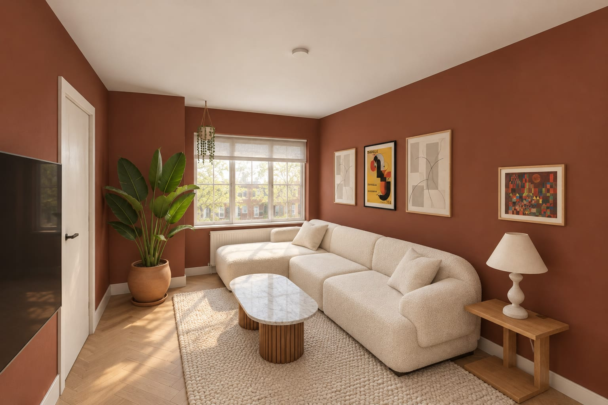
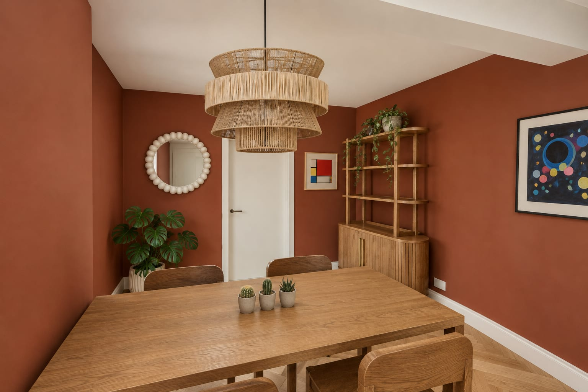
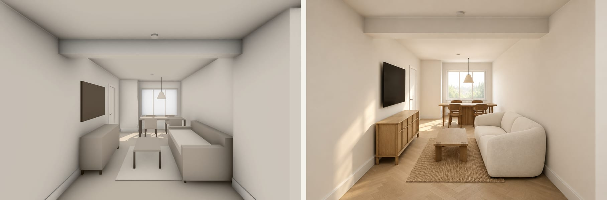
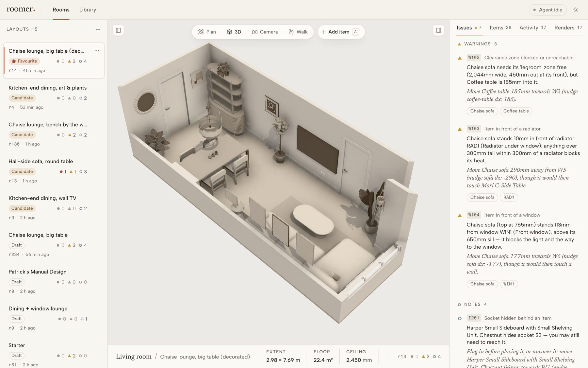
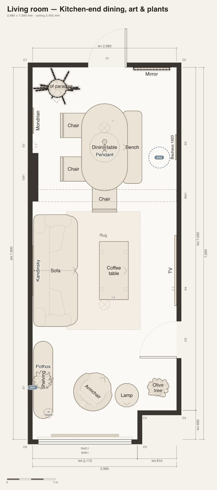
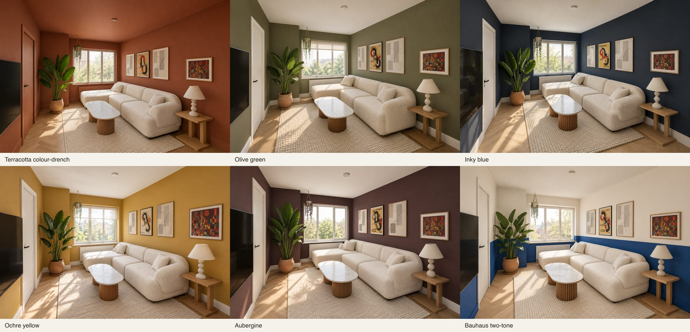

# roomer

**Design the rooms in your house by talking to an AI.** Roomer keeps a precise model of a room — walls,
doors, windows, radiators, sockets, the ceiling beam — plus the furniture you're considering and any
number of candidate layouts. Your AI agent (Claude Code, over MCP) does the designing: it builds 3D
blockouts of real products from their links, arranges them, and fixes what Roomer's **layout linter**
flags. You watch it happen live in the browser, drag things around yourself, walk through the room in
first person, and get **photoreal renders** of any layout.



<p align="center">
  
  
</p>

## How it works

1. **Measure the room once.** Dictate wall lengths (and diagonals, for wonky old rooms) to your agent;
   Roomer solves the outline and stores doors, windows, radiators, sockets and beams.
2. **Add furniture from product links.** The agent reads the listing, then builds the piece from simple
   parts (boxes, rounded slabs, cylinders, lathes, tori…) at the listed size, checking its clay
   previews against the product photos.
3. **Design layouts.** The agent places things with wall-relative helpers ("back against the left wall,
   1.2m along") and every change is linted: overlaps, blocked doors and walkways, chairs with no room
   to pull out, sofas in front of radiators, things floating in mid-air — each with a concrete fix.
4. **Look at it.** Architect-style floor plan, 3D orbit, saved camera views, or **walk mode**: first
   person at your height, bump into furniture, jump, sit on the sofa, lie on the floor.
5. **Render it.** Roomer renders a grey "clay" view plus a colour-coded map of what's where, and an
   image model paints it photorealistically using each product's own photo.



<p align="center">
  
  
</p>

## Features

- **Workspace** — layouts rail (draft → candidate → favourite), live updates while the agent works,
  and an inspector with lint issues, items and prices, an activity feed and render history.
- **Plan editing** — drag items, rectangle-select and move groups, nudge and rotate with the keyboard,
  raise/lower or "rest on" furniture, and **Add item** with live lint and wall snapping.
- **Walk mode** — WASD + mouse, Space to jump, C to sit, Z to lie down, your height adjustable,
  Esc to pause, Enter to take a photoreal "photo" of exactly what you see.
- **Library** — every piece with its clay previews, product photos, size and price.
- **24 MCP tools** — rooms, features, assets, layouts, lint, floor plan / 3D / photoreal renders. The
  server hands agents a guide ([docs/agent-guide.md](docs/agent-guide.md)) with the conventions.
- **Linter** — 14 rules (collisions per part, outside the room, door swings, doorways, walking routes
  on a 25mm grid, clearance zones, radiators, windows, beams, floating items, hidden sockets…),
  running in a few milliseconds on every change.

## Getting started

You need Node 22+, pnpm 10 and macOS or Linux.

```bash
pnpm install
```

```bash
pnpm --filter web exec playwright install chromium
```

```bash
pnpm dev
```

That starts a local Convex backend (no account needed) on :3210 and the app on
http://localhost:3000. With it running, load the example living room — 67 pieces of furniture,
prints and plants, and several designed layouts:

```bash
pnpm seed --import
```

**Photoreal renders** use the [Vercel AI Gateway](https://vercel.com/ai-gateway): put
`AI_GATEWAY_API_KEY=...` in a `.env.local` at the repo root (a render costs a few pence). Without a
key, start with `PHOTOREAL_STUB=1 pnpm dev` to get free placeholder renders; everything else works.

### Design with Claude Code

The repo's `.mcp.json` registers the `roomer` MCP server (`http://localhost:3000/api/mcp/mcp`). Run
`claude` in this folder, approve the server, and try:

> Show me the living room plan, then add this sofa \<product link\> and try a layout with it facing the window.

To use it from any folder:

```bash
claude mcp add --transport http roomer http://localhost:3000/api/mcp/mcp
```

Or call tools by hand (images land in `.roomer-out/mcp/`):

```bash
pnpm mcp get_overview '{}'
```

## Under the hood

|                    |                                                                                                                        |
| ------------------ | ---------------------------------------------------------------------------------------------------------------------- |
| `apps/web`         | Next.js 16 app: UI, `/render` page, MCP endpoint, render + photoreal pipelines                                         |
| `packages/core`    | Pure TypeScript domain: zod schemas (single source of truth), geometry, room solver, placement, linter, floor-plan SVG |
| `packages/backend` | Convex: tables derived from the core schemas, functions, seed/export/import                                            |
| `packages/ui`      | Design system (Tailwind v4 + shadcn/radix)                                                                             |
| `apps/e2e`         | Playwright end-to-end suite on an isolated stack                                                                       |

3D is three.js via React Three Fiber; clay and colour-coded renders come from a headless Chromium
that loads the app's own `/render` page, so the renders use exactly the same scene code as the UI.
Photoreal renders send the clay view, the colour map and product photos to
`openai/gpt-image-2.5-sunburst` (see the [model comparison](docs/2026-10-11-photoreal-spike.md)).

```bash
pnpm test
```

```bash
pnpm e2e
```

~1,500 unit tests and ~50 end-to-end tests. Conventions for contributors (and agents) are in
[CLAUDE.md](CLAUDE.md); the [spec](docs/spec.md), [architecture](docs/2026-10-11-v1-architecture.md)
and [status](docs/2026-10-11-v1-status.md) docs explain the rest.

## Notes

- Built in a day with Claude Code: a team of agents wrote the code while another dogfooded the MCP
  tools by furnishing a real living room (their reports are in `docs/2026-10-11-dogfood-*.md`).
- The example furniture is real products researched from Castlery UK; prints are public-domain
  Bauhaus-era works (via Wikimedia Commons) and a few Postery posters; plants are from Patch Plants.
  The repo stores only links — product photos are downloaded from the retailers when you import.
  Roomer isn't affiliated with any of them.
- Everything runs locally for a single user; there's no auth.
